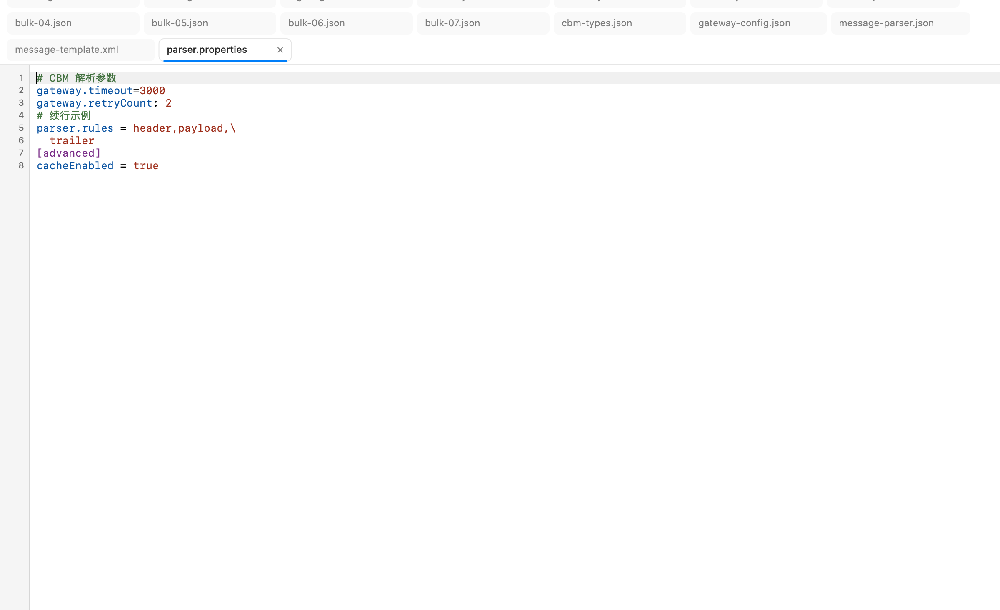
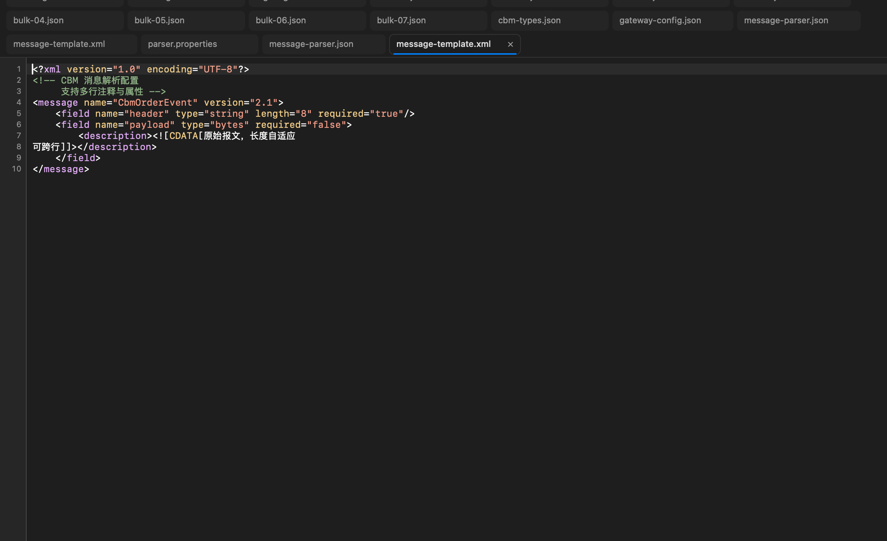
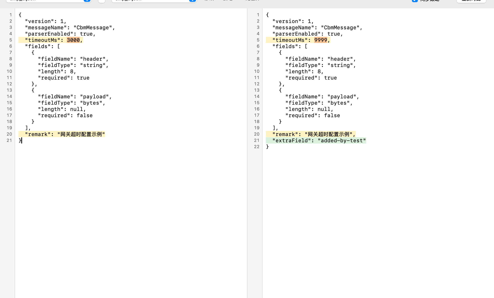

# SwiftNote

macOS 上的轻量文本编辑器，原生 AppKit + TextKit II，无第三方依赖。

它想解决的是一件事：**同时摊开十几个配置文件来回对照**。主流编辑器清一色单行标签 +
横向滚动，开满之后只剩文件名后缀能区分；SwiftNote 把标签折成多行，一眼看完。



## 功能

- **多行标签页**（核心差异）：标签自动换行、拖拽排序、中键关闭；行数上限 1~6 行（默认 5），
  超出后末行内部横向滚动并显示溢出计数，不再挤压编辑区
- **三格式语法高亮**：JSON / XML / Properties，深浅两套配色，随输入增量更新
- **JSON 格式化与校验**：`⌘⇧F` 一键格式化（2 空格缩进），错误行内标红并在状态栏给出行列号，
  点击跳转；整篇格式化为一步撤销
- **选区转 JSON**：在纯文本或任意文件中选中一段 XML 报文，右键「转换为 JSON」原地替换。
  保留根元素名、键序与属性（`@attr`），文本一律按字符串处理，不把 `007` 变成 `7`
- **搜索替换**：正则 / 区分大小写 / 整词，全量命中计数 + 滚动条命中标记，全部替换可一次撤销
- **双屏文件对比**：行级 diff + 行内差异高亮、同步滚动、`⌥⌘↑/↓` 逐处跳转，可直接编辑并实时刷新
- **编码**：UTF-8 / GBK（GB18030）自动识别与手动切换，保留原文件 BOM，切换前对未保存修改做确认
- **大文件保护**：超过阈值（默认 10MB，可在设置里调整）自动只读打开；这个量级的文件不再进
  TextKit，改用自绘只读面板，滚动流畅且仍可选中、复制、搜索与折行
- **会话恢复**：标签顺序、滚动位置、未保存草稿（停笔 2 秒落盘），崩溃后同样能恢复
- **文件管理**：原子写、外部修改监视与冲突提示、拖拽打开、`⌘⇧O` 快速打开最近文件

| 深色主题 | 双屏对比 |
| --- | --- |
|  |  |

## 环境要求

- macOS 14 或更新
- Swift 5.9+：完整 Xcode 15+，或 Command Line Tools（`xcode-select --install`）

项目没有外部依赖，`Package.swift` 里没有任何远程包，不需要 `swift package resolve` 之外的网络操作。

## 构建与运行

```bash
# 直接跑（开发态，窗口从终端启动）
swift build --disable-sandbox
swift run --disable-sandbox SwiftNote

# 打包成可双击的 .app → dist/SwiftNote.app
./tools/build-app.sh release
open dist/SwiftNote.app
```

`--disable-sandbox` 是给只有 Command Line Tools 的机器准备的：SwiftPM 的构建沙箱会拦住
打包脚本用到的部分工具链路径。装了完整 Xcode 的环境可以直接去掉这个参数，也可以用 Xcode
打开 `Package.swift` 正常构建。

另有一个不与正式版冲突的开发版（独立 bundle id，落在 `~/Library/Caches/SwiftNote-dev/`）：

```bash
./tools/build-app.sh dev
./tools/build-app.sh clean   # 注销并清掉两份产物
```

## 目录结构

```
Sources/SwiftNoteKit/Core             领域层：文档模型、编码转换、语法高亮引擎、
                                      JSON/XML 服务、搜索、diff、会话快照（不依赖 AppKit）
Sources/SwiftNoteKit/Infrastructure   基础设施：原子写、外部修改监视、草稿存储、日志
Sources/SwiftNote/App                 AppKit 应用层：窗口、菜单、快捷键映射、生命周期
Sources/SwiftNote/Features           特性层：标签栏、编辑器容器、状态栏、
                                      搜索栏、对比窗口、快速打开、设置
tools/                                打包脚本、图标生成、测试数据生成
docs/                                 PRD、设计说明书（含 ADR 决策记录）、评审报告
prototypes/m0                         TextKit II 与大文件渲染的技术预研
```

## 快捷键

| 操作 | 快捷键 | 操作 | 快捷键 |
| --- | --- | --- | --- |
| 新建 | `⌘N` | 打开 | `⌘O` |
| 保存 | `⌘S` | 另存为 | `⌘⇧S` |
| 快速打开最近文件 | `⌘⇧O` | 从磁盘重新加载 | `⌘R` |
| 关闭标签 | `⌘W` | 对比文件 | `⌘⇧D` |
| 格式化 JSON | `⌘⇧F` | 查找 | `⌘F` |
| 查找并替换 | `⌥⌘F` | 查找下一个 / 上一个 | `⌘G` / `⌘⇧G` |
| 上一个 / 下一个标签 | `⌘⇧[` / `⌘⇧]` | 下一处 / 上一处差异 | `⌥⌘↓` / `⌥⌘↑` |
| 设置 | `⌘,` | 在 Finder 中显示 | 无（右键菜单） |

全部键位都可以在「设置 → 快捷键」里改，包括清除为未绑定。

## 数据存放

- 会话与草稿：`~/Library/Application Support/SwiftNote/`（`session.json` + `drafts/`）
- 日志：走 `NSLog`，在 Console.app 里按 `SwiftNote` 过滤

应用只读写你主动打开的文件，不联网、不上报。

## 开发辅助脚本

```bash
python3 tools/gen_test_files.py       # 生成 1MB / 50MB / 200MB 基准文件到 tools/testdata/
python3 tools/gen_samples.py 40       # 生成多标签、三格式高亮用的小样例
swift tools/make-icon.swift build/icon  # 重新生成应用图标
```

`tools/testdata/` 是脚本产物（约 250MB），不随仓库分发，需要时自行生成。

## 已知限制

- 大文件只读面板切换「自动换行」会整篇重排，4MB 量级约需数秒
- 单行超长（几 MB 挤在一行）的文件仍会阻塞主线程，尚未做分行预处理
- 对比窗口里的大文件面板未跟进折行（同步滚动按行号映射，折行后会错位，故暂不开启）
- 未做代码签名与公证，产物仅供本机/内部使用

## 许可证

[Apache License 2.0](LICENSE)
